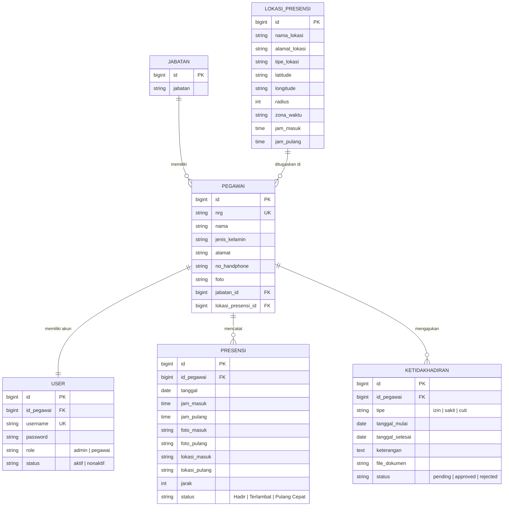

# 📱 Presensi App - Sistem Presensi Online & Manajemen Pegawai

[](https://laravel.com)
[](https://php.net)
[](https://getbootstrap.com)
[](https://web.dev/progressive-web-apps/)
[](https://github.com/AchmaddZacky)
[](LICENSE)

**Presensi App** adalah sistem informasi presensi pegawai berbasis web modern yang dibangun menggunakan **Laravel 13**, **Bootstrap 5**, dan arsitektur **Progressive Web App (PWA)**. Aplikasi ini dirancang untuk mendigitalisasi proses absensi kehadiran karyawan secara akurat, aman, dan efisien menggunakan validasi swafoto (webcam selfie), koordinat GPS (*Geofencing radius*), pengajuan izin/sakit/cuti, serta rekapitulasi laporan otomatis ke format PDF dan CSV.

---

## 📑 Daftar Isi
- [Fitur Utama](#-fitur-utama)
  - [1. Panel Administrator](#1-panel-administrator)
  - [2. Portal Pegawai](#2-portal-pegawai)
  - [3. Fitur Keamanan & Geofencing](#3-fitur-keamanan--geofencing)
  - [4. Progressive Web App (PWA)](#4-progressive-web-app-pwa)
- [Teknologi yang Digunakan](#-teknologi-yang-digunakan)
- [Struktur Folder Proyek](#-struktur-folder-proyek)
- [Skema Basis Data](#-skema-basis-data)
- [Panduan Instalasi & Menjalankan](#-panduan-instalasi--menjalankan)
  - [Prasyarat Sistem](#prasyarat-sistem)
  - [Langkah Instalasi](#langkah-instalasi)
- [Akun Pengguna Default](#-akun-pengguna-default)
- [Daftar Rute Utama](#-daftar-rute-utama)
- [Catatan Penggunaan & Izin Perangkat](#-catatan-penggunaan--izin-perangkat)
- [Lisensi](#-lisensi)

---

## ✨ Fitur Utama

### 1. Panel Administrator
- **Dashboard Statistik Interaktif:**
  - Ringkasan total pegawai, total kantor/lokasi, pegawai hadir hari ini, terlambat, dan pengajuan ketidakhadiran yang menunggu persetujuan (*pending*).
  - Jam digital langsung (*real-time live clock*) dengan format tanggal Indonesia.
- **Manajemen Jabatan (CRUD):**
  - Pengelolaan data jabatan/posisi kerja pegawai (tambah, ubah, hapus).
- **Manajemen Lokasi Presensi (CRUD & Map Picker):**
  - Menentukan nama kantor/lokasi, alamat lengkap, dan tipe lokasi.
  - Penentuan titik koordinat (*Latitude* & *Longitude*) menggunakan peta interaktif Leaflet.
  - Pengaturan batas radius geofencing (dalam satuan meter).
  - Jam operasional kantor (jam masuk, batas toleransi keterlambatan, dan jam pulang).
- **Manajemen Data Pegawai (CRUD):**
  - Pendataan pegawai lengkap: NRG (Nomor Registrasi Pegawai), Nama Lengkap, Jenis Kelamin, Alamat, No. HP, Jabatan, dan Penempatan Lokasi Presensi.
  - Unggah foto profil pegawai.
  - Otomatis membuatkan akun login sistem untuk pegawai yang baru didaftarkan.
- **Monitoring & Rekap Presensi:**
  - **Rekap Harian:** Menampilkan daftar presensi pegawai per tanggal terpilih.
  - **Rekap Mingguan:** Monitoring absensi per rentang minggu dalam bulan tertentu.
  - **Rekap Bulanan:** Matriks kehadiran lengkap pegawai dalam satu bulan kalender.
  - Filter komprehensif berdasarkan: Kantor/Lokasi, Pegawai, Status Kehadiran, dan Periode Waktu.
- **Export Laporan:**
  - **Cetak Dokumen PDF:** Format siap cetak yang rapi dan profesional menggunakan library `barryvdh/laravel-dompdf`.
  - **Export CSV/Excel:** Unduhan data mentah untuk kebutuhan pengolahan data atau payroll.
- **Approval Ketidakhadiran (Izin, Sakit, Cuti):**
  - Tinjauan berkas permohonan ketidakhadiran dari pegawai.
  - Fitur unduh dan pratinjau bukti dokumen/surat dokter.
  - Tombol aksi satu-klik: *Approve* (Setujui) atau *Reject* (Tolak) dengan konfirmasi SweetAlert2.
- **Pengaturan Profil Admin:**
  - Pembaruan nama profil, username, password akun, dan foto profil administrator.

---

### 2. Portal Pegawai
- **Dashboard Personal Pegawai:**
  - Kartu identitas pegawai (nama, jabatan, kantor penempatan, status akun).
  - Jam kerja aktif dan live clock.
  - Status presensi hari ini: Jam masuk (*Clock In*), jam pulang (*Clock Out*), serta status keterlambatan.
  - Statistik ringkas kehadiran personal per bulan.
- **Presensi Masuk (Clock In):**
  - Pengambilan foto langsung (*live selfie capture*) melalui webcam laptop atau kamera smartphone.
  - Deteksi geolokasi otomatis (GPS browser).
  - Validasi jarak real-time terhadap titik kantor penempatan:
    - Jika pegawai **berada di dalam radius**: Presensi berhasil dicatat beserta jarak tempuh meter.
    - Jika pegawai **berada di luar radius**: Sistem menolak presensi dan menampilkan peringatan jarak.
- **Presensi Pulang (Clock Out):**
  - Fitur pencatatan kepulangan dengan swafoto kepulangan dan koordinat lokasi pulang.
- **Riwayat Presensi Personal:**
  - Rekam jejak seluruh riwayat absensi pegawai.
  - Modal pratinjau foto presensi masuk dan keluar.
  - Penanda status visual: *Tepat Waktu*, *Terlambat*, *Pulang Cepat*, atau *Tidak Hadir*.
- **Pengajuan Ketidakhadiran:**
  - Formulir pengajuan izin, sakit, atau cuti.
  - Pengunggahan berkas bukti (surat keterangan dokter/dokumen pendukung dalam format PDF, JPG, atau PNG).
  - Pelacakan status persetujuan (*Pending*, *Approved*, atau *Rejected*).
- **Pengaturan Profil Pegawai:**
  - Pembaruan informasi kontak pribadi, kata sandi, dan foto profil.

---

### 3. Fitur Keamanan & Geofencing
- **Haversine Formula Geofencing:** Menghitung jarak lengkung bumi matematis antara koordinat GPS pegawai saat ini dengan koordinat kantor penempatan dalam presisi satuan meter.
- **Anti Fraud Foto:** Swafoto diambil langsung dari kamera *real-time* via Canvas HTML5 (bukan unggah gambar dari galeri/penyimpanan lokal).
- **Multi-Role Middleware Protection:**
  - Middleware `admin` mengamankan rute-rute manajemen administratif.
  - Middleware `pegawai` mengamankan area presensi dan riwayat khusus karyawan.
- **Enkripsi Password:** Enkripsi aman `Bcrypt` bawaan Laravel.
- **Proteksi CSRF & XSS:** Seluruh formulir diproteksi oleh Laravel CSRF tokens dan *sanitized output*.

---

### 4. Progressive Web App (PWA)
- **Installable Web App:** Dapat diinstal langsung ke layar beranda (*Home Screen*) pada perangkat Android, iOS, maupun Desktop (Google Chrome/Edge) layaknya aplikasi native.
- **Service Worker (`public/sw.js`):**
  - Caching aset statis (CSS, Fonts, Icons, JS) untuk waktu muat instan (*blazing-fast performance*).
  - Strategi *Network-First with Offline Fallback* untuk menjaga data presensi selalu terkini saat online, dan menampilkan halaman cadangan saat offline.
- **Halaman Offline Elegan (`public/offline.html`):** Halaman ramah pengguna dengan tombol *Coba Lagi* otomatis saat jaringan terputus.
- **Aset Manifest & Ikon Standar:** `site.webmanifest` & `manifest.json` lengkap dengan dukungan ikon *maskable* (192x192 dan 512x512).

---

## 🛠️ Teknologi yang Digunakan

| Kategori | Teknologi / Pustaka |
| :--- | :--- |
| **Backend Framework** | [Laravel 13.x](https://laravel.com) (v13.31.0) |
| **Bahasa Pemrograman** | PHP 8.3 / 8.4 |
| **Basis Data** | MySQL / MariaDB |
| **Styling & CSS** | [Bootstrap 5.3](https://getbootstrap.com) & Vanilla CSS Tokens |
| **Ikon Antarmuka** | [Bootstrap Icons v1.11](https://icons.getbootstrap.com/) |
| **Tipografi** | Google Fonts ([Inter](https://fonts.google.com/specimen/Inter) & [Outfit](https://fonts.google.com/specimen/Outfit)) |
| **Dialog & Alert** | [SweetAlert2](https://sweetalert2.github.io/) |
| **Pemetaan & Peta** | [Leaflet.js](https://leafletjs.com/) |
| **Webcam Engine** | HTML5 MediaDevices API & Canvas Streaming |
| **Ekspor PDF** | [barryvdh/laravel-dompdf](https://github.com/barryvdh/laravel-dompdf) (v3.0) |
| **Asset Bundler** | [Vite](https://vitejs.dev/) |

---

## 📁 Struktur Folder Proyek

Berikut adalah gambaran hierarki direktori utama beserta penjelasan fungsinya:

```text
Presensi-App/
├── app/
│   ├── Http/
│   │   ├── Controllers/
│   │   │   ├── Admin/                      # Controller untuk modul Administrator
│   │   │   │   ├── DashboardController.php      # Statistik & ringkasan admin
│   │   │   │   ├── JabatanController.php        # CRUD Master Data Jabatan
│   │   │   │   ├── KetidakhadiranController.php # Verifikasi pengajuan izin/sakit
│   │   │   │   ├── LaporanExportController.php  # Generator ekspor PDF & CSV
│   │   │   │   ├── LokasiPresensiController.php # CRUD Lokasi Kantor & Geofencing
│   │   │   │   ├── PegawaiController.php        # CRUD Master Pegawai & Akun
│   │   │   │   ├── PresensiController.php       # Rekap presensi harian/mingguan/bulanan
│   │   │   │   └── ProfileController.php        # Pengaturan profil Admin
│   │   │   ├── Auth/
│   │   │   │   └── LoginController.php          # Login multi-role & Logout
│   │   │   └── Pegawai/                    # Controller untuk modul Pegawai
│   │   │       ├── DashboardController.php      # Dashboard & ringkasan pegawai
│   │   │       ├── KetidakhadiranController.php # Pengajuan izin/sakit & riwayat
│   │   │       ├── PresensiController.php       # Form Clock-In & Clock-Out + validasi jarak
│   │   │       ├── ProfileController.php        # Pengaturan profil Pegawai
│   │   │       └── RiwayatController.php        # Riwayat kehadiran pegawai
│   │   └── Middleware/
│   │       ├── AdminMiddleware.php         # Pembatasan hak akses role admin
│   │       └── PegawaiMiddleware.php       # Pembatasan hak akses role pegawai
│   └── Models/
│       ├── Jabatan.php                     # Model tabel jabatan
│       ├── Ketidakhadiran.php              # Model tabel ketidakhadiran
│       ├── LokasiPresensi.php              # Model tabel lokasi_presensi
│       ├── Pegawai.php                     # Model tabel pegawai
│       ├── Presensi.php                    # Model tabel presensi (clock in/out, foto, koordinat)
│       └── User.php                        # Model autentikasi (role: admin/pegawai)
├── bootstrap/
│   └── app.php                             # Inisialisasi aplikasi & pendaftaran middleware (Laravel 13)
├── config/                                 # Seluruh berkas konfigurasi sistem
├── database/
│   ├── migrations/                         # Skema pembentukan tabel & indeks performa
│   └── seeders/
│       └── DatabaseSeeder.php              # Seeder data master, kantor, dan akun default
├── public/
│   ├── images/                             # Logo aplikasi dan aset grafis
│   ├── android-chrome-192x192.png          # Ikon PWA 192px
│   ├── android-chrome-512x512.png          # Ikon PWA 512px
│   ├── apple-touch-icon.png                # Ikon PWA untuk perangkat iOS
│   ├── favicon.ico / favicon-32x32.png     # Favicon aplikasi
│   ├── manifest.json / site.webmanifest    # Konfigurasi metadata PWA
│   ├── sw.js                               # Service Worker PWA (caching & offline sync)
│   └── offline.html                        # Halaman cadangan saat koneksi terputus
├── resources/
│   ├── css/                                # Asset sumber CSS (Vite)
│   ├── js/                                 # Asset sumber JS (Vite)
│   └── views/
│       ├── admin/                          # Tampilan halaman Administrator
│       │   ├── dashboard.blade.php              # Tampilan dashboard admin
│       │   ├── jabatan/                         # View CRUD Jabatan
│       │   ├── ketidakhadiran/                  # View Approval Ketidakhadiran
│       │   ├── lokasi-presensi/                 # View CRUD Lokasi & Peta Geofence
│       │   ├── pegawai/                         # View CRUD Pegawai
│       │   ├── presensi/                        # View Rekap Harian, Mingguan, Bulanan & Cetak
│       │   └── profile/                         # View Profil Admin
│       ├── auth/
│       │   └── login.blade.php                  # Halaman masuk sistem terpadu
│       ├── components/                     # Komponen blade reusable
│       │   ├── alert.blade.php                  # Komponen flash message
│       │   ├── clock-widget.blade.php           # Komponen jam digital real-time
│       │   ├── password-toggle.blade.php        # Input password dengan intip sandi
│       │   └── webcam-capture.blade.php         # Kamera selfie & canvas capture
│       ├── layouts/
│       │   ├── app.blade.php                    # Master layout utama (meta, assets, PWA)
│       │   ├── admin.blade.php                  # Layout sidebar/topbar admin
│       │   └── pegawai.blade.php                # Layout antarmuka pegawai
│       └── pegawai/                        # Tampilan halaman Pegawai
│           ├── dashboard.blade.php              # Dashboard pegawai
│           ├── ketidakhadiran/                  # Pengajuan & riwayat izin/sakit
│           ├── presensi/                        # Form selfie & validasi GPS masuk/pulang
│           ├── profile/                         # Profil pegawai
│           └── riwayat/                         # Tabel riwayat absensi personal
├── routes/
│   └── web.php                             # Seluruh definisi rute web, auth, admin, & pegawai
├── storage/
│   └── app/public/                         # Penyimpanan berkas foto selfie presensi, profil, & surat dokter
├── .env.example                            # Templat konfigurasi environment
├── composer.json                           # Dependensi package PHP
├── package.json                            # Dependensi package JavaScript
└── vite.config.js                          # Konfigurasi bundler Vite
```

---

## 🗄️ Skema Basis Data

Sistem menggunakan relasi entitas berikut:



---

## 🚀 Panduan Instalasi & Menjalankan

### Prasyarat Sistem
Pastikan perangkat Anda telah terpasang:
- **PHP** versi 8.3 atau lebih baru (dengan ekstensi `pdo_mysql`, `mbstring`, `openssl`, `curl`, `gd`, `fileinfo`)
- **Composer** versi 2.x
- **Node.js** (v18.x atau v20.x LTS) & **NPM**
- **MySQL / MariaDB**

---

### Langkah Instalasi

1. **Clone Repositori:**
   ```bash
   git clone https://github.com/AchmaddZacky/Presensi-App.git
   cd Presensi-App
   ```

2. **Pasang Dependensi PHP (Composer):**
   ```bash
   composer install
   ```

3. **Pasang Dependensi JavaScript (NPM):**
   ```bash
   npm install
   ```

4. **Siapkan Berkas Environment (`.env`):**
   Salin berkas templat konfigurasi environment:
   ```bash
   cp .env.example .env
   ```
   *(Pada sistem operasi Windows PowerShell, gunakan `copy .env.example .env`)*

5. **Generate Application Key:**
   ```bash
   php artisan key:generate
   ```

6. **Konfigurasi Basis Data pada `.env`:**
   Buka file `.env` dan sesuaikan koneksi database lokal Anda:
   ```env
   DB_CONNECTION=mysql
   DB_HOST=127.0.0.1
   DB_PORT=3306
   DB_DATABASE=presensi_app
   DB_USERNAME=root
   DB_PASSWORD=
   ```
   *Pastikan database dengan nama `presensi_app` sudah dibuat di MySQL/phpMyAdmin Anda.*

7. **Jalankan Migrasi & Seeder Database:**
   Perintah ini akan membuat semua tabel dan mengisi data master awal (kantor, jabatan, akun admin & pegawai):
   ```bash
   php artisan migrate --seed
   ```

8. **Buat Symlink Penyimpanan Berkas (*Storage Link*):**
   Wajib dijalankan agar foto selfie presensi dan bukti dokumen dapat diakses secara publik:
   ```bash
   php artisan storage:link
   ```

9. **Build Aset Frontend:**
   - Untuk mode pengembangan (*Hot Reload*):
     ```bash
     npm run dev
     ```
   - Atau untuk kompilasi berkas produksi:
     ```bash
     npm run build
     ```

10. **Jalankan Server Lokal:**
    Buka terminal baru dan jalankan:
    ```bash
    php artisan serve
    ```
    Buka browser Anda dan akses aplikasi di: **`http://127.0.0.1:8000`**

---

## 🔑 Akun Pengguna Default

Data uji coba awal yang otomatis digenerate dari `DatabaseSeeder`:

| Role | Username | Password | Deskripsi / Penugasan |
| :--- | :--- | :--- | :--- |
| **Administrator** | `admin` | `password` | Akses penuh seluruh panel kontrol, rekap, dan approval |
| **Pegawai** | `pegawai1` | `password` | Akun pegawai uji coba (Kantor 1, Jabatan: Staff) |

> 💡 *Catatan Keamanan:* Segera ganti kata sandi default ini melalui menu **Profil** setelah aplikasi digunakan di lingkungan kerja nyata.

---

## 🌐 Daftar Rute Utama

### Modul Publik & Autentikasi
| Method | URI | Nama Rute | Keterangan |
| :--- | :--- | :--- | :--- |
| `GET` | `/` | - | Redirect otomatis ke halaman login |
| `GET` | `/login` | `login` | Halaman form login akun |
| `POST` | `/login` | - | Proses autentikasi masuk |
| `POST` | `/logout` | `logout` | Logout dan pembersihan sesi |

### Modul Administrator (`/admin/*`)
| Method | URI | Nama Rute | Keterangan |
| :--- | :--- | :--- | :--- |
| `GET` | `/admin/dashboard` | `admin.dashboard` | Dashboard analitik & ringkasan |
| `GET\|POST` | `/admin/jabatan` | `admin.jabatan.index` | CRUD data jabatan |
| `GET\|POST` | `/admin/lokasi-presensi` | `admin.lokasi-presensi.index`| CRUD kantor & radius geofencing |
| `GET\|POST` | `/admin/pegawai` | `admin.pegawai.index` | CRUD data pegawai & user |
| `GET` | `/admin/presensi/harian` | `admin.presensi.harian` | Rekapitulasi absensi harian |
| `GET` | `/admin/presensi/mingguan` | `admin.presensi.mingguan` | Rekapitulasi absensi mingguan |
| `GET` | `/admin/presensi/bulanan` | `admin.presensi.bulanan` | Rekapitulasi absensi bulanan |
| `GET` | `/admin/presensi/export` | `admin.presensi.export` | Download rekapitulasi format PDF |
| `GET` | `/admin/presensi/export-csv` | `admin.presensi.export-csv` | Download rekapitulasi format CSV |
| `GET` | `/admin/ketidakhadiran` | `admin.ketidakhadiran.index`| Daftar pengajuan izin/sakit/cuti |
| `PATCH` | `/admin/ketidakhadiran/{id}/approve` | `admin.ketidakhadiran.approve` | Persetujuan ketidakhadiran |
| `PATCH` | `/admin/ketidakhadiran/{id}/reject` | `admin.ketidakhadiran.reject` | Penolakan ketidakhadiran |
| `GET\|PUT` | `/admin/profile` | `admin.profile.index` | Pengaturan profil admin |

### Modul Pegawai (`/pegawai/*`)
| Method | URI | Nama Rute | Keterangan |
| :--- | :--- | :--- | :--- |
| `GET` | `/pegawai/dashboard` | `pegawai.dashboard` | Dashboard ringkasan absensi pegawai |
| `GET` | `/pegawai/presensi` | `pegawai.presensi.index` | Smart redirect form presensi aktif |
| `GET\|POST`| `/pegawai/presensi/masuk` | `pegawai.presensi.clock-in` | Validasi webcam & GPS jam masuk |
| `GET\|POST`| `/pegawai/presensi/pulang` | `pegawai.presensi.clock-out`| Validasi webcam & GPS jam pulang |
| `GET` | `/pegawai/riwayat` | `pegawai.riwayat.index` | Riwayat kehadiran & preview foto |
| `GET\|POST`| `/pegawai/ketidakhadiran/create` | `pegawai.ketidakhadiran.create` | Formulir pengajuan izin/sakit |
| `GET` | `/pegawai/ketidakhadiran/riwayat`| `pegawai.ketidakhadiran.riwayat`| Status persetujuan pengajuan |
| `GET\|PUT` | `/pegawai/profile` | `pegawai.profile.index` | Pengaturan data diri & ganti password |

---

## 📷 Catatan Penggunaan & Izin Perangkat

1. **Akses Kamera (Webcam):**
   - Saat membuka form presensi masuk/pulang, izinkan (*Allow*) browser untuk mengakses kamera perangkat Anda.
   - Diperlukan untuk mengambil swafoto verifikasi kehadiran secara langsung.
2. **Akses Lokasi (GPS Geolocation):**
   - Izinkan (*Allow*) browser mengakses lokasi perangkat (*Location permission*).
   - Pastikan GPS pada smartphone atau laptop Anda dalam keadaan aktif.
3. **Protokol HTTPS / Localhost:**
   - Fitur Web API Camera dan Geolocation mewajibkan konteks aman (*Secure Context*).
   - Berjalan normal tanpa sertifikat SSL pada `http://localhost` atau `http://127.0.0.1`.
   - Jika di-deploy ke server online/production, domain **wajib menggunakan HTTPS (SSL Certificate)** agar kamera dan GPS dapat diakses.

---

## 📄 Lisensi

Proyek ini dirilis di bawah lisensi terbuka [MIT License](LICENSE). Anda dipersilakan untuk mempelajari, memodifikasi, dan mengembangkannya sesuai kebutuhan institusi atau perusahaan Anda.

---

<p align="center">
  Dibuat oleh <a href="https://github.com/AchmaddZacky"><strong>@AchmaddZacky</strong></a>
</p>
